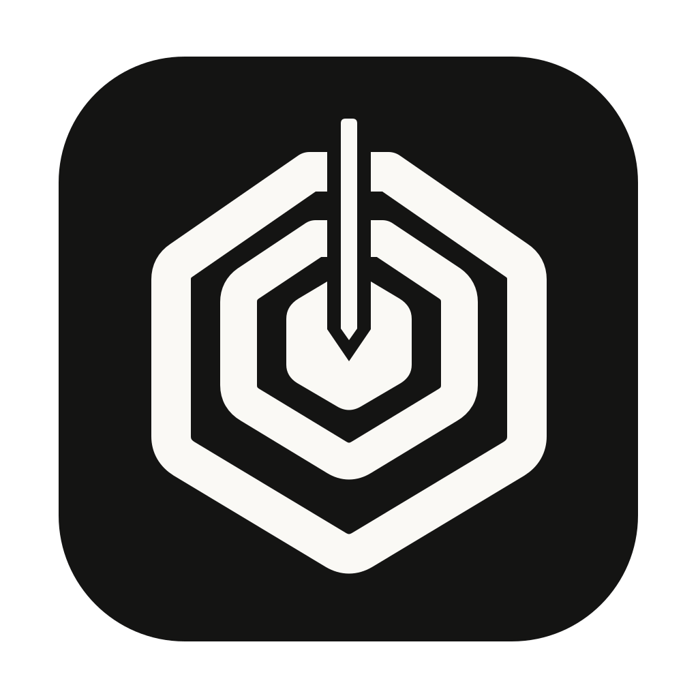
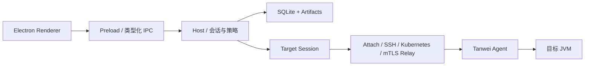

<p align="center">
  
</p>

<h1 align="center">探微（Tanwei）</h1>

<p align="center">
  源码开放、仅限非商业使用的 JVM Runtime Workbench
</p>

探微是一款面向 Java 开发者和生产支持团队的桌面诊断工具。它把 JVM 目标发现、在线诊断、
性能分析、长时任务与诊断证据组织在同一个工作台中，并通过类型化 Action 和分级策略控制
诊断成本与运行时风险。

> 当前版本为 `0.1.0`，处于积极开发阶段。核心诊断闭环已经可用，协议和扩展 API 在
> `1.0.0` 前仍可能调整。

## 为什么选择探微

- **Local-first**：工作区、审计、案例和诊断制品默认保存在本机。
- **源码可审阅**：允许在非商业目的下使用、研究、修改和分发。
- **一体化工作台**：从目标接入、实时观测到制品归档，不需要在多个工具间切换。
- **结构化诊断**：Host 与 Agent 使用版本化 Protobuf/gRPC 和 Action Contract 通信，
  不向目标 JVM 透传任意文本命令。
- **风险可控**：操作按 R0—R4 分级，高成本或修改类操作需要预检、限额和确认。
- **证据优先**：结果经过 Host 校验、哈希和原子落盘后，才能成为可跨会话引用的制品。

## 核心能力

- 本机 JVM、SSH、Kubernetes 与 mTLS 持久 Relay 目标接入
- CPU、Heap、GC、线程、锁、类加载、JIT、PerfCounter 与运行时配置检查
- 方法观测、源码行探针、调用快照、Monitor 与跨类 Trace
- async-profiler、JFR、Heap Dump、火焰图与 Heap 对象分析
- MBean、JUL、Logback、Log4j 1.x/2 检查与受控修改
- 活动任务、诊断审计、不可变制品、案例和签名诊断模板

实际可用能力取决于目标 JDK、连接方式、Agent 能力声明和本机/团队策略。

## 快速开始

### 环境要求

| 依赖 | 要求 |
| --- | --- |
| Node.js | `22.12.0 ≤ 22.x < 23` 或 `≥ 24`；`.nvmrc` 使用 `22.22.3` |
| npm | `≥ 11.6.2` |
| JDK | 推荐 JDK 21，需包含 `jlink`、`javac` 和 `include/jvmti.h` |
| Maven | 推荐 3.9+ |
| Native 工具链 | macOS：Xcode CLT；Linux：GCC/Clang；Windows：MSVC Build Tools |

生产 JVM 模块以 Java 8 字节码为基线；CI 覆盖 JDK 8、11、17、21、25，以及 macOS
arm64/x64、Linux x64 和 Windows x64。

### 从源码启动

```bash
nvm use
npm ci
npm run build:jvm
npm run dev
```

首次连接目标前必须完成 `build:jvm`。之后只有 JVM 或 Native 代码变化时才需要重新构建。
开发模式会同时启动 Vite 和 Electron，请不要单独打开生成的 HTML。

启动后，在“目标”页刷新本机进程，选择可 Attach 的 JVM 并连接。目标进程通常需要与探微
属于同一系统用户，且未启用 `-XX:+DisableAttachMechanism`；否则可使用远程接入方式。

## 构建与验证

| 命令 | 用途 |
| --- | --- |
| `npm run dev` | 启动桌面开发环境 |
| `npm run build` | 构建 Plugin SDK、Native/JVM 组件和桌面应用 |
| `npm test` | 运行元数据、UI、类型、单元与 JVM 测试 |
| `npm run package:test` | 生成当前平台的未签名目录包 |
| `npm run test:e2e` | 对已生成的目录包运行真实 Attach E2E |
| `npm run test:soak:smoke` | 对已生成的目录包运行 45 秒稳定性冒烟 |

完整本地验证：

```bash
npm run verify
```

`verify` 会依次运行完整测试、当前平台目录包和真实 Attach E2E。

### 发布

推送到 `main` 或创建 Pull Request 会触发跨 JDK、跨平台验证。正式版本通过与 Desktop
版本一致的标签发布，例如 `0.1.0` 对应 `v0.1.0`：

```bash
git tag v0.1.0
git push origin v0.1.0
```

Release 工作流要求配置 macOS Developer ID 与公证凭据，以及 Windows 代码签名证书；凭据
缺失时会拒绝发布。安装包、更新元数据和版本说明由工作流统一写入 GitHub Release。

## 架构



Renderer 负责交互；Electron 主进程负责连接生命周期、授权、持久化和制品校验；Agent 在目标
JVM 内再次校验 Action、能力与输入预算。领域模型见 [`CONTEXT.md`](CONTEXT.md)。

## 项目结构

```text
.
├── apps/desktop/          # Electron + React 桌面应用
├── packages/plugin-sdk/   # 声明式签名扩展 SDK
├── jvm/                   # Agent、Protocol、Relay 与集成测试
├── contracts/             # 协议兼容契约
├── scripts/               # 构建、打包、发布与验证脚本
└── tests/e2e/             # 打包应用 E2E
```

## 安全边界

- 不开放任意 Shell、OGNL、Telnet/HTTP 文本命令或插件代码注入。
- 风险等级由共享 Action 描述符和 Host Policy 决定，Renderer 不能自行降级。
- 高风险操作由 Agent 重新验证输入边界、目标身份和预检指纹。
- Plugin SDK 只允许贡献已存在的 R0/R1 声明式模板，不加载插件 JavaScript 或 Native 代码。

扩展格式与签名示例见
[`packages/plugin-sdk/README.md`](packages/plugin-sdk/README.md)。

## 参与贡献

欢迎通过 Issue 报告 Bug、提出功能建议或补充诊断场景，也欢迎提交 Pull Request。

提交改动前请：

1. 对较大的功能或架构调整先创建 Issue，说明使用场景、边界和预期行为。
2. 保持改动聚焦，并为行为变化补充测试或可复现证据。
3. 运行 `npm test`；涉及桌面完整链路时，再运行 `npm run package:test` 和
   `npm run test:e2e`。
4. 在 Pull Request 中说明风险、验证结果以及兼容性影响。

项目优先接受边界明确、可取消、可审计且不会绕过 Action Policy 的诊断能力。
提交的贡献将按本项目相同的非商业许可证提供。

## 许可证

探微采用 [PolyForm Noncommercial License 1.0.0](LICENSE)。你可以为个人学习、研究、实验
及其他非商业目的使用、修改和分发本项目；商业用途不在授权范围内，必须事先取得权利人的
另行授权。

由于许可证限制商业使用，本项目属于**源码开放（source-available）**，而不是 OSI 定义的
开源软件。随项目分发的第三方组件继续适用其各自许可证，详见
[第三方许可证说明](licenses/THIRD_PARTY_NOTICES.md)。
